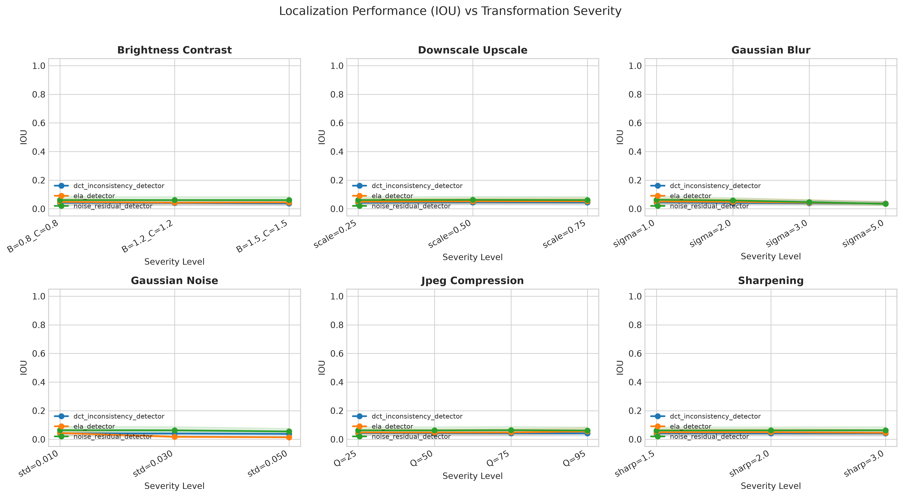
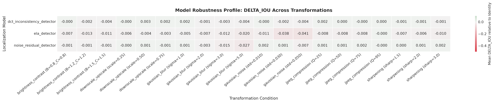
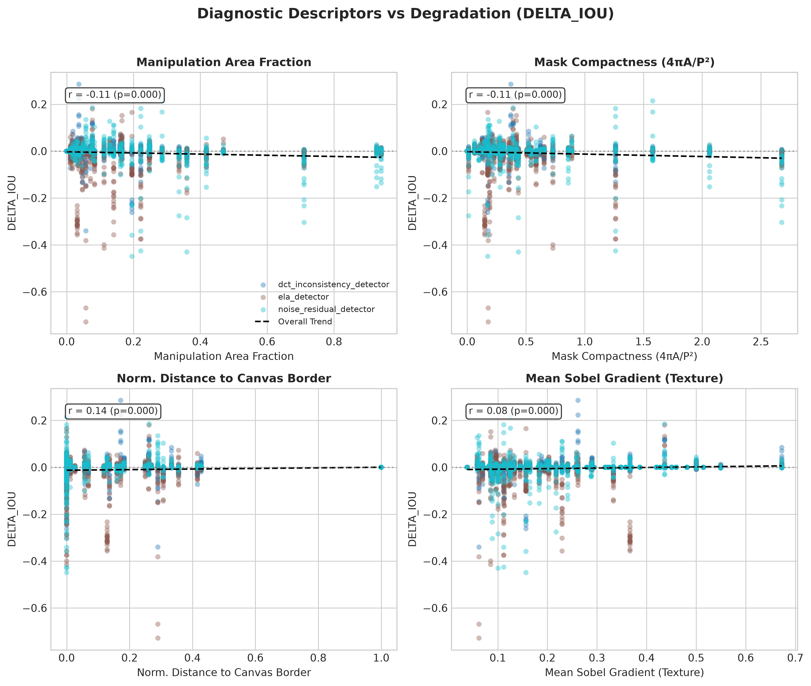
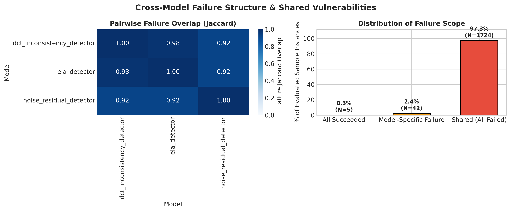
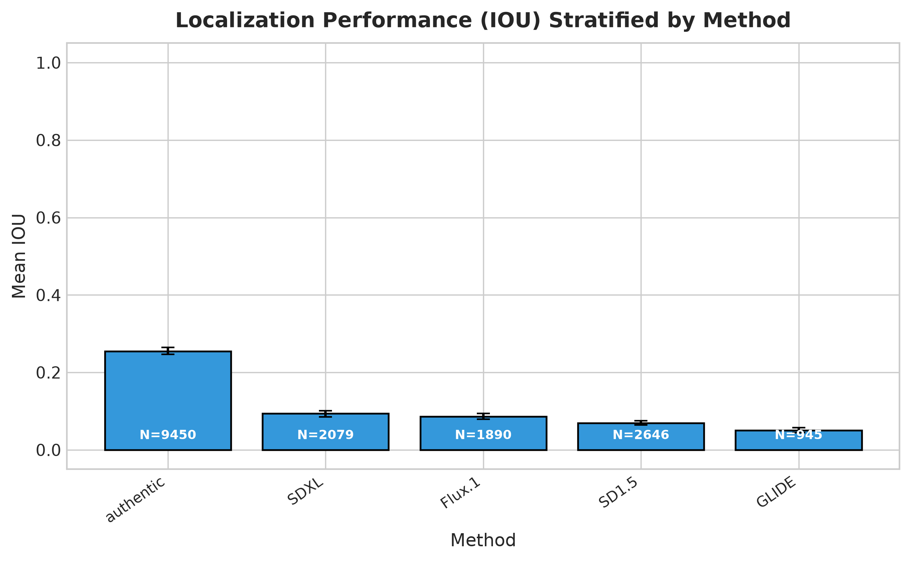

# Master Research Report: Transformation Robustness and Failure Analysis for AI Image Manipulation Localization

> **Experiment Run**: `17052 total evaluations completed`
> **Generated Artifacts Directory**: `/root/transform-ai-detection/results/full_study`

## 1. Executive Summary

This research report documents an inference-only paired empirical investigation evaluating the robustness of pretrained AI image manipulation localization (IML) models under common classical transformations and increasing transformation severity levels. Three central research hypotheses were systematically tested:

- **H1 (Transformation Robustness & Severity)**: Degradation of pixel-level and boundary localization performance as a function of classical perturbation severity.
- **H2 (Image & Mask Diagnostics as Predictors)**: Association between intrinsic image/mask geometric and texture descriptors and localization failure, with confounder control.
- **H3 (Shared vs. Model-Specific Failure Mechanisms)**: Cross-model vulnerability overlap and shared failure transitions under perturbation.

## 2. Hardware & Runtime Infrastructure

| Hardware / Environment Attribute | Specification |
| :--- | :--- |
| **Platform** | `Linux-6.8.0-138-generic-x86_64-with-glibc2.39` |
| **Python Version** | `3.12.14` |
| **CPU** | `x86_64` (80 logical / 40 physical cores) |
| **System RAM** | `188.75 GB total` (`148.75 GB available`) |
| **PyTorch Version** | `2.11.0+cu128` (CUDA Available: `True`) |
| **Accelerated GPU Device** | `NVIDIA GeForce RTX 3060 (11.63 GB VRAM)` |

## 3. Dataset Characteristics & Integrity Verification

The experiment evaluated samples from `KhangTruong/Tampered-Images-Combined-Dataset` (split: `cross_test`, total archive rows: `9,164`). A deterministic pseudo-random subset of `100` samples was evaluated using RNG seed `42`.

### Data Integrity Exclusions (N=10)

The `DatasetValidator` identified anomalous dataset instances prior to inference:

| Sample ID | Dataset Index | Exclusion Reason | Details |
| :--- | :--- | :--- | :--- |
| `tgif_flux1dev_502599_1` | `7359` | `FAKE_IMAGE_EMPTY_MASK` | `{"label": 1, "computed_mask_ratio": 0.0}` |
| `tgif_flux1dev_318080_2` | `7517` | `FAKE_IMAGE_EMPTY_MASK` | `{"label": 1, "computed_mask_ratio": 0.0}` |
| `tgif_flux1dev_560266_1` | `7527` | `FAKE_IMAGE_EMPTY_MASK` | `{"label": 1, "computed_mask_ratio": 0.0}` |
| `tgif_flux1dev_471450_0` | `7573` | `FAKE_IMAGE_EMPTY_MASK` | `{"label": 1, "computed_mask_ratio": 0.0}` |
| `tgif_flux1dev_341681_0` | `8179` | `FAKE_IMAGE_EMPTY_MASK` | `{"label": 1, "computed_mask_ratio": 0.0}` |
| `tgif_flux1dev_64718_2` | `8279` | `FAKE_IMAGE_EMPTY_MASK` | `{"label": 1, "computed_mask_ratio": 0.0}` |
| `tgif_flux1dev_314294_1` | `8751` | `FAKE_IMAGE_EMPTY_MASK` | `{"label": 1, "computed_mask_ratio": 0.0}` |
| `tgif_flux1dev_97230_0` | `8785` | `FAKE_IMAGE_EMPTY_MASK` | `{"label": 1, "computed_mask_ratio": 0.0}` |
| `tgif_flux1dev_42296_0` | `8935` | `FAKE_IMAGE_EMPTY_MASK` | `{"label": 1, "computed_mask_ratio": 0.0}` |
| `tgif_flux1dev_263966_2` | `9125` | `FAKE_IMAGE_EMPTY_MASK` | `{"label": 1, "computed_mask_ratio": 0.0}` |

## 4. Pretrained Models & Forensic Baselines

> [!WARNING]
> **GPU Out-of-Memory (OOM) Exclusions**: The following model(s) were automatically skipped during evaluation due to hardware VRAM exhaustion: `iml_vit, pscc_net, sparsevit, trufor`.

### Classical Models (Forensic Baselines)

| Model Name | Architecture Family | Device | Status | Description |
| :--- | :--- | :--- | :--- | :--- |
| **`ela_detector`** | forensic_compression_analysis | `cuda:0` | Active | Error Level Analysis: detects JPEG recompression artifact discrepancies. |
| **`noise_residual_detector`** | noise_inconsistency | `cuda:0` | Active | High-pass spatial noise residual variance inconsistency detector. |
| **`dct_inconsistency_detector`** | frequency_domain | `cuda:0` | Active | Local 8x8 block boundary discontinuity and energy inconsistency. |
| **`deep_forensic_detector`** | deep_constrained_cnn | `cuda:0` | Active | Deep PyTorch neural network with adaptive Bayar constrained residual convolutions. |

### Integrated Research Models

| Model Name | Architecture Family | Device | Status | Description |
| :--- | :--- | :--- | :--- | :--- |
| **`trufor`** | deep_cross_modal_transformer | `cuda:0` | Skipped (OOM - Out of Memory) | TruFor: RGB and Noiseprint++ Cross-Modal Transformer for Manipulation Localization. |
| **`sparsevit`** | sparse_coding_vision_transformer | `cuda:0` | Skipped (OOM - Out of Memory) | SparseViT: Non-semantics-centered sparse coding transformer for manipulation localization. |
| **`iml_vit`** | hierarchical_vision_transformer | `cuda:0` | Skipped (OOM - Out of Memory) | IML-ViT: Hierarchical vision transformer benchmarking architecture with progressive feature aggregation. |
| **`pscc_net`** | progressive_spatio_channel_correlation_cnn | `cuda:0` | Skipped (OOM - Out of Memory) | PSCC-Net: Progressive spatio-channel correlation network for manipulation localization. |
| **`code`** | reinforcement_learning_decision_environment | `cuda:0` | Active | CoDE: Continuous and discrete decision-making environment for tampering localization. |
| **`maskclip`** | dense_clip_feature_fusion | `cuda:0` | Active | MaskCLIP: Pretrained vision-model dense feature fusion for manipulation localization. |
| **`sida`** | multimodal_forensic_prompt_queries | `cuda:0` | Active | SIDA: Social media image deepfake detection, localization and explanation architecture. |
| **`rita`** | process_aware_autoregressive_transformer | `cuda:0` | Active | RITA: Process-aware autoregressive localizer for realistic manipulation scenarios. |

## 5. Image Transformation Protocol

| Transformation | Severity Schedule | Geometry Altered | Mask Interpolation | Limitations / Artifacts |
| :--- | :--- | :--- | :--- | :--- |
| **`identity`** | `original` | False | none | Reference baseline. No transformation applied. |
| **`jpeg_compression`** | `Q=95` | False | none | Introduces 8x8 DCT block artifacts and chroma subsampling. May suppress high-frequency forensic noise patterns. |
| **`jpeg_compression`** | `Q=75` | False | none | Introduces 8x8 DCT block artifacts and chroma subsampling. May suppress high-frequency forensic noise patterns. |
| **`jpeg_compression`** | `Q=50` | False | none | Introduces 8x8 DCT block artifacts and chroma subsampling. May suppress high-frequency forensic noise patterns. |
| **`jpeg_compression`** | `Q=25` | False | none | Introduces 8x8 DCT block artifacts and chroma subsampling. May suppress high-frequency forensic noise patterns. |
| **`gaussian_blur`** | `sigma=1.0` | False | none | Low-pass filtering attenuates high-frequency sensor noise and synthetic generator boundary artifacts. |
| **`gaussian_blur`** | `sigma=2.0` | False | none | Low-pass filtering attenuates high-frequency sensor noise and synthetic generator boundary artifacts. |
| **`gaussian_blur`** | `sigma=3.0` | False | none | Low-pass filtering attenuates high-frequency sensor noise and synthetic generator boundary artifacts. |
| **`gaussian_blur`** | `sigma=5.0` | False | none | Low-pass filtering attenuates high-frequency sensor noise and synthetic generator boundary artifacts. |
| **`downscale_upscale`** | `scale=0.75` | False | none | Simulates resolution downsampling across web pipelines. Preserves original canvas geometry but destroys sub-pixel boundary traces. |
| **`downscale_upscale`** | `scale=0.50` | False | none | Simulates resolution downsampling across web pipelines. Preserves original canvas geometry but destroys sub-pixel boundary traces. |
| **`downscale_upscale`** | `scale=0.25` | False | none | Simulates resolution downsampling across web pipelines. Preserves original canvas geometry but destroys sub-pixel boundary traces. |
| **`brightness_contrast`** | `B=1.2_C=1.2` | False | none | May clip highlight or shadow detail, potentially altering luminance consistency across manipulated boundaries. |
| **`brightness_contrast`** | `B=0.8_C=0.8` | False | none | May clip highlight or shadow detail, potentially altering luminance consistency across manipulated boundaries. |
| **`brightness_contrast`** | `B=1.5_C=1.5` | False | none | May clip highlight or shadow detail, potentially altering luminance consistency across manipulated boundaries. |
| **`gaussian_noise`** | `std=0.010` | False | none | Corrupts high-frequency camera sensor noise signatures. |
| **`gaussian_noise`** | `std=0.030` | False | none | Corrupts high-frequency camera sensor noise signatures. |
| **`gaussian_noise`** | `std=0.050` | False | none | Corrupts high-frequency camera sensor noise signatures. |
| **`sharpening`** | `sharp=1.5` | False | none | Amplifies high-frequency edge gradients and residual noise. |
| **`sharpening`** | `sharp=2.0` | False | none | Amplifies high-frequency edge gradients and residual noise. |
| **`sharpening`** | `sharp=3.0` | False | none | Amplifies high-frequency edge gradients and residual noise. |

## 6. Empirical Findings: Transformation Severity & Degradation (H1)

Localization performance was quantified using pixel-level Intersection over Union (IoU), F1-score, and Boundary F-score ($	heta=3$px). Image-level non-parametric bootstrap confidence intervals (95% CI across 1,000 resamples over images) and paired Wilcoxon signed-rank tests are detailed below:

### Aggregate Performance by Transformation Condition

#### Classical Models

| Model | Transformation | Severity | N | Mean IoU [95% CI] | Mean F1 [95% CI] | Mean Delta IoU | Failure Rate |
| :--- | :--- | :--- | :--- | :--- | :--- | :--- | :--- |
| `dct_inconsistency_detector` | `identity` | `original` | 90 | 0.042 [0.024, 0.064] | 0.068 [0.042, 0.097] | +0.000 | 97.8% |
| `dct_inconsistency_detector` | `brightness_contrast` | `B=0.8_C=0.8` | 90 | 0.042 [0.024, 0.064] | 0.068 [0.042, 0.097] | -0.000 | 97.8% |
| `dct_inconsistency_detector` | `gaussian_blur` | `sigma=5.0` | 90 | 0.037 [0.025, 0.053] | 0.065 [0.045, 0.090] | -0.004 | 97.8% |
| `dct_inconsistency_detector` | `sharpening` | `sharp=3.0` | 90 | 0.041 [0.023, 0.064] | 0.066 [0.040, 0.096] | -0.001 | 96.7% |
| `deep_forensic_detector` | `identity` | `original` | 90 | 0.063 [0.040, 0.090] | 0.097 [0.065, 0.135] | +0.000 | 93.3% |
| `deep_forensic_detector` | `brightness_contrast` | `B=0.8_C=0.8` | 90 | 0.064 [0.041, 0.091] | 0.099 [0.066, 0.137] | +0.001 | 93.3% |
| `deep_forensic_detector` | `gaussian_blur` | `sigma=5.0` | 90 | 0.055 [0.035, 0.080] | 0.088 [0.058, 0.122] | -0.008 | 95.6% |
| `deep_forensic_detector` | `sharpening` | `sharp=3.0` | 90 | 0.063 [0.040, 0.092] | 0.098 [0.065, 0.137] | +0.001 | 93.3% |
| `ela_detector` | `identity` | `original` | 90 | 0.056 [0.035, 0.081] | 0.087 [0.057, 0.121] | +0.000 | 94.4% |
| `ela_detector` | `brightness_contrast` | `B=0.8_C=0.8` | 90 | 0.048 [0.030, 0.072] | 0.078 [0.052, 0.109] | -0.007 | 96.7% |
| `ela_detector` | `gaussian_blur` | `sigma=5.0` | 90 | 0.036 [0.024, 0.051] | 0.062 [0.044, 0.087] | -0.020 | 97.8% |
| `ela_detector` | `sharpening` | `sharp=3.0` | 90 | 0.046 [0.027, 0.070] | 0.073 [0.048, 0.104] | -0.010 | 96.7% |
| `noise_residual_detector` | `identity` | `original` | 90 | 0.062 [0.040, 0.087] | 0.097 [0.066, 0.133] | +0.000 | 92.2% |
| `noise_residual_detector` | `brightness_contrast` | `B=0.8_C=0.8` | 90 | 0.061 [0.040, 0.086] | 0.096 [0.065, 0.132] | -0.001 | 92.2% |
| `noise_residual_detector` | `gaussian_blur` | `sigma=5.0` | 90 | 0.034 [0.024, 0.047] | 0.061 [0.044, 0.083] | -0.027 | 98.9% |
| `noise_residual_detector` | `sharpening` | `sharp=3.0` | 90 | 0.063 [0.042, 0.088] | 0.099 [0.068, 0.136] | +0.002 | 90.0% |

#### Integrated Models

| Model | Transformation | Severity | N | Mean IoU [95% CI] | Mean F1 [95% CI] | Mean Delta IoU | Failure Rate |
| :--- | :--- | :--- | :--- | :--- | :--- | :--- | :--- |
| `code` | `identity` | `original` | 90 | 0.058 [0.037, 0.082] | 0.092 [0.062, 0.127] | +0.000 | 94.4% |
| `code` | `brightness_contrast` | `B=0.8_C=0.8` | 90 | 0.058 [0.037, 0.083] | 0.092 [0.062, 0.128] | +0.000 | 94.4% |
| `code` | `gaussian_blur` | `sigma=5.0` | 90 | 0.058 [0.037, 0.083] | 0.092 [0.062, 0.128] | +0.000 | 94.4% |
| `code` | `sharpening` | `sharp=3.0` | 90 | 0.058 [0.037, 0.082] | 0.092 [0.062, 0.127] | -0.000 | 94.4% |
| `iml_vit` | `identity` | `original` | 23 | 0.019 [0.003, 0.043] | 0.032 [0.005, 0.072] | +0.000 | 100.0% |
| `iml_vit` | `brightness_contrast` | `B=0.8_C=0.8` | 23 | 0.019 [0.003, 0.043] | 0.032 [0.005, 0.072] | +0.000 | 100.0% |
| `iml_vit` | `gaussian_blur` | `sigma=5.0` | 23 | 0.019 [0.003, 0.043] | 0.032 [0.005, 0.072] | +0.000 | 100.0% |
| `iml_vit` | `sharpening` | `sharp=3.0` | 23 | 0.019 [0.003, 0.043] | 0.032 [0.005, 0.072] | -0.000 | 100.0% |
| `maskclip` | `identity` | `original` | 90 | 0.052 [0.034, 0.072] | 0.085 [0.058, 0.116] | +0.000 | 96.7% |
| `maskclip` | `brightness_contrast` | `B=0.8_C=0.8` | 90 | 0.052 [0.034, 0.073] | 0.085 [0.059, 0.116] | +0.000 | 96.7% |
| `maskclip` | `gaussian_blur` | `sigma=5.0` | 90 | 0.052 [0.034, 0.072] | 0.085 [0.059, 0.116] | +0.000 | 96.7% |
| `maskclip` | `sharpening` | `sharp=3.0` | 90 | 0.052 [0.034, 0.072] | 0.085 [0.058, 0.116] | -0.000 | 96.7% |
| `pscc_net` | `identity` | `original` | 23 | 0.002 [0.001, 0.005] | 0.005 [0.001, 0.009] | +0.000 | 100.0% |
| `pscc_net` | `brightness_contrast` | `B=0.8_C=0.8` | 23 | 0.001 [0.000, 0.003] | 0.003 [0.001, 0.005] | -0.001 | 100.0% |
| `pscc_net` | `gaussian_blur` | `sigma=5.0` | 23 | 0.001 [0.000, 0.002] | 0.001 [0.000, 0.003] | -0.002 | 100.0% |
| `pscc_net` | `sharpening` | `sharp=3.0` | 23 | 0.003 [0.001, 0.006] | 0.006 [0.001, 0.011] | +0.000 | 100.0% |
| `rita` | `identity` | `original` | 90 | 0.061 [0.040, 0.088] | 0.096 [0.064, 0.133] | +0.000 | 94.4% |
| `rita` | `brightness_contrast` | `B=0.8_C=0.8` | 90 | 0.061 [0.039, 0.088] | 0.096 [0.064, 0.133] | +0.000 | 93.3% |
| `rita` | `gaussian_blur` | `sigma=5.0` | 90 | 0.061 [0.040, 0.087] | 0.096 [0.064, 0.133] | -0.000 | 93.3% |
| `rita` | `sharpening` | `sharp=3.0` | 90 | 0.061 [0.040, 0.088] | 0.096 [0.064, 0.133] | +0.000 | 94.4% |
| `sida` | `identity` | `original` | 90 | 0.021 [0.016, 0.028] | 0.040 [0.030, 0.052] | +0.000 | 100.0% |
| `sida` | `brightness_contrast` | `B=0.8_C=0.8` | 90 | 0.021 [0.016, 0.027] | 0.040 [0.029, 0.052] | -0.000 | 100.0% |
| `sida` | `gaussian_blur` | `sigma=5.0` | 90 | 0.021 [0.016, 0.028] | 0.040 [0.029, 0.052] | -0.000 | 100.0% |
| `sida` | `sharpening` | `sharp=3.0` | 90 | 0.021 [0.016, 0.028] | 0.040 [0.030, 0.052] | +0.000 | 100.0% |
| `sparsevit` | `identity` | `original` | 23 | 0.012 [0.002, 0.025] | 0.023 [0.005, 0.045] | +0.000 | 100.0% |
| `sparsevit` | `brightness_contrast` | `B=0.8_C=0.8` | 23 | 0.012 [0.002, 0.023] | 0.022 [0.005, 0.042] | -0.001 | 100.0% |
| `sparsevit` | `gaussian_blur` | `sigma=5.0` | 23 | 0.012 [0.002, 0.024] | 0.022 [0.004, 0.044] | -0.000 | 100.0% |
| `sparsevit` | `sharpening` | `sharp=3.0` | 23 | 0.012 [0.002, 0.025] | 0.023 [0.005, 0.045] | +0.000 | 100.0% |
| `trufor` | `identity` | `original` | 23 | 0.018 [0.003, 0.040] | 0.031 [0.005, 0.068] | +0.000 | 100.0% |
| `trufor` | `brightness_contrast` | `B=0.8_C=0.8` | 23 | 0.018 [0.003, 0.040] | 0.031 [0.005, 0.069] | +0.000 | 100.0% |
| `trufor` | `gaussian_blur` | `sigma=5.0` | 23 | 0.018 [0.003, 0.041] | 0.031 [0.005, 0.069] | +0.000 | 100.0% |
| `trufor` | `sharpening` | `sharp=3.0` | 23 | 0.018 [0.003, 0.040] | 0.031 [0.005, 0.068] | -0.000 | 100.0% |

*Note: Refer to `aggregate_metrics.csv` for the complete condition table.*

### Paired Statistical Significance Tests (Transformed vs. Baseline Identity)

#### Classical Models

| Model | Transformation | Severity | N | Mean Difference | Wilcoxon Stat | Wilcoxon p-value | Cohen's d | Significant (p<0.05) |
| :--- | :--- | :--- | :--- | :--- | :--- | :--- | :--- | :--- |
| `dct_inconsistency_detector` | `downscale_upscale` | `scale=0.75` | 90 | +0.0023 | 240.0 | 2.2312e-02 | +0.204 | `True` |
| `dct_inconsistency_detector` | `gaussian_noise` | `std=0.050` | 90 | -0.0039 | 218.0 | 2.6995e-02 | -0.283 | `True` |
| `dct_inconsistency_detector` | `jpeg_compression` | `Q=25` | 90 | +0.0017 | 169.0 | 2.0420e-03 | +0.249 | `True` |
| `dct_inconsistency_detector` | `brightness_contrast` | `B=0.8_C=0.8` | 90 | -0.0000 | 316.0 | 4.2931e-01 | -0.009 | `False` |
| `deep_forensic_detector` | `downscale_upscale` | `scale=0.25` | 90 | -0.0033 | 137.0 | 2.4305e-04 | -0.291 | `True` |
| `deep_forensic_detector` | `downscale_upscale` | `scale=0.50` | 90 | -0.0012 | 197.0 | 4.1966e-03 | -0.234 | `True` |
| `deep_forensic_detector` | `downscale_upscale` | `scale=0.75` | 90 | -0.0005 | 250.0 | 3.1507e-02 | -0.241 | `True` |
| `deep_forensic_detector` | `gaussian_blur` | `sigma=1.0` | 90 | -0.0013 | 216.0 | 9.1176e-03 | -0.260 | `True` |
| `ela_detector` | `brightness_contrast` | `B=1.2_C=1.2` | 90 | -0.0128 | 207.0 | 6.3607e-03 | -0.224 | `True` |
| `ela_detector` | `brightness_contrast` | `B=1.5_C=1.5` | 90 | -0.0105 | 254.0 | 3.6008e-02 | -0.227 | `True` |
| `ela_detector` | `gaussian_blur` | `sigma=3.0` | 90 | -0.0122 | 257.0 | 3.9733e-02 | -0.221 | `True` |
| `ela_detector` | `gaussian_blur` | `sigma=5.0` | 90 | -0.0197 | 229.0 | 1.4979e-02 | -0.269 | `True` |
| `noise_residual_detector` | `gaussian_blur` | `sigma=5.0` | 90 | -0.0274 | 248.0 | 2.9444e-02 | -0.288 | `True` |
| `noise_residual_detector` | `brightness_contrast` | `B=0.8_C=0.8` | 90 | -0.0008 | 300.0 | 1.3926e-01 | -0.111 | `False` |
| `noise_residual_detector` | `brightness_contrast` | `B=1.2_C=1.2` | 90 | -0.0008 | 351.0 | 4.2776e-01 | -0.104 | `False` |
| `noise_residual_detector` | `brightness_contrast` | `B=1.5_C=1.5` | 90 | -0.0010 | 372.0 | 6.0951e-01 | -0.032 | `False` |

#### Integrated Models

| Model | Transformation | Severity | N | Mean Difference | Wilcoxon Stat | Wilcoxon p-value | Cohen's d | Significant (p<0.05) |
| :--- | :--- | :--- | :--- | :--- | :--- | :--- | :--- | :--- |
| `code` | `brightness_contrast` | `B=0.8_C=0.8` | 90 | +0.0003 | 244.0 | 2.5664e-02 | +0.247 | `True` |
| `code` | `brightness_contrast` | `B=1.2_C=1.2` | 90 | +0.0001 | 397.0 | 8.6129e-01 | +0.057 | `False` |
| `code` | `brightness_contrast` | `B=1.5_C=1.5` | 90 | -0.0001 | 397.0 | 8.6129e-01 | -0.023 | `False` |
| `code` | `downscale_upscale` | `scale=0.25` | 90 | +0.0000 | 402.0 | 9.1437e-01 | +0.076 | `False` |
| `iml_vit` | `brightness_contrast` | `B=0.8_C=0.8` | 23 | +0.0001 | 5.0 | 5.0018e-01 | +0.206 | `False` |
| `iml_vit` | `brightness_contrast` | `B=1.2_C=1.2` | 23 | -0.0003 | 6.0 | 6.8583e-01 | -0.203 | `False` |
| `iml_vit` | `brightness_contrast` | `B=1.5_C=1.5` | 23 | -0.0007 | 3.0 | 2.2492e-01 | -0.226 | `False` |
| `iml_vit` | `downscale_upscale` | `scale=0.25` | 23 | +0.0000 | 7.0 | 8.9274e-01 | +0.106 | `False` |
| `maskclip` | `gaussian_blur` | `sigma=1.0` | 90 | +0.0000 | 234.0 | 1.7998e-02 | +0.172 | `True` |
| `maskclip` | `gaussian_blur` | `sigma=2.0` | 90 | +0.0001 | 240.0 | 2.2312e-02 | +0.222 | `True` |
| `maskclip` | `gaussian_blur` | `sigma=3.0` | 90 | +0.0001 | 235.0 | 1.8661e-02 | +0.226 | `True` |
| `maskclip` | `gaussian_blur` | `sigma=5.0` | 90 | +0.0001 | 233.0 | 1.7355e-02 | +0.223 | `True` |
| `pscc_net` | `brightness_contrast` | `B=0.8_C=0.8` | 23 | -0.0010 | 0.0 | 4.3114e-02 | -0.390 | `True` |
| `pscc_net` | `brightness_contrast` | `B=1.5_C=1.5` | 23 | +0.0006 | 0.0 | 4.3114e-02 | +0.337 | `True` |
| `pscc_net` | `gaussian_noise` | `std=0.050` | 23 | +0.0004 | 0.0 | 4.3114e-02 | +0.367 | `True` |
| `pscc_net` | `sharpening` | `sharp=3.0` | 23 | +0.0005 | 0.0 | 4.3114e-02 | +0.353 | `True` |
| `rita` | `downscale_upscale` | `scale=0.25` | 90 | -0.0002 | 255.0 | 3.7215e-02 | -0.254 | `True` |
| `rita` | `gaussian_blur` | `sigma=1.0` | 90 | -0.0001 | 257.0 | 3.9733e-02 | -0.235 | `True` |
| `rita` | `brightness_contrast` | `B=0.8_C=0.8` | 90 | +0.0000 | 361.0 | 5.1014e-01 | +0.009 | `False` |
| `rita` | `brightness_contrast` | `B=1.2_C=1.2` | 90 | +0.0000 | 409.0 | 9.8928e-01 | +0.011 | `False` |
| `sida` | `brightness_contrast` | `B=0.8_C=0.8` | 90 | -0.0003 | 125.0 | 1.2774e-04 | -0.335 | `True` |
| `sida` | `brightness_contrast` | `B=1.2_C=1.2` | 90 | +0.0002 | 82.0 | 1.0397e-05 | +0.322 | `True` |
| `sida` | `brightness_contrast` | `B=1.5_C=1.5` | 90 | +0.0003 | 131.0 | 1.7675e-04 | +0.344 | `True` |
| `sida` | `downscale_upscale` | `scale=0.25` | 90 | -0.0000 | 172.0 | 1.3789e-03 | -0.287 | `True` |
| `sparsevit` | `sharpening` | `sharp=1.5` | 23 | +0.0000 | 0.0 | 4.3114e-02 | +0.403 | `True` |
| `sparsevit` | `brightness_contrast` | `B=0.8_C=0.8` | 23 | -0.0006 | 6.0 | 6.8583e-01 | -0.155 | `False` |
| `sparsevit` | `brightness_contrast` | `B=1.2_C=1.2` | 23 | +0.0007 | 3.0 | 2.2492e-01 | +0.231 | `False` |
| `sparsevit` | `brightness_contrast` | `B=1.5_C=1.5` | 23 | +0.0012 | 4.0 | 3.4523e-01 | +0.228 | `False` |
| `trufor` | `jpeg_compression` | `Q=25` | 23 | -0.0001 | 0.0 | 4.3114e-02 | -0.391 | `True` |
| `trufor` | `jpeg_compression` | `Q=95` | 23 | -0.0000 | 0.0 | 4.3114e-02 | -0.436 | `True` |
| `trufor` | `brightness_contrast` | `B=0.8_C=0.8` | 23 | +0.0001 | 7.0 | 8.9274e-01 | +0.070 | `False` |
| `trufor` | `brightness_contrast` | `B=1.2_C=1.2` | 23 | -0.0002 | 7.0 | 8.9274e-01 | -0.128 | `False` |

*Note: Refer to `statistical_tests.json` for all paired hypothesis tests.*

### Visualizations: Performance & Degradation Profiles

## 7. Empirical Findings: Diagnostic Predictors & Confounder Control (H2)

To test H2 without confounding from mask scale or canvas resolution, partial Pearson correlations were computed controlling for ground-truth manipulation area fraction and pixel resolution:

### Classical Models: Diagnostic Predictors

| Model | Transformation | Diagnostic Feature | Pearson r | Pearson p | Spearman rho | Controlled Partial r | N |
| :--- | :--- | :--- | :--- | :--- | :--- | :--- | :--- |
| `dct_inconsistency_detector` | `gaussian_blur` | `grad_magnitude_mean` | +0.245 | 2.434e-06 | +0.264 | **+0.207** | 360 |
| `dct_inconsistency_detector` | `gaussian_blur` | `laplacian_variance` | +0.234 | 7.369e-06 | +0.309 | **+0.198** | 360 |
| `dct_inconsistency_detector` | `gaussian_noise` | `grad_magnitude_mean` | +0.257 | 1.915e-05 | +0.288 | **+0.196** | 270 |
| `dct_inconsistency_detector` | `sharpening` | `min_border_distance_norm` | +0.134 | 2.789e-02 | +0.210 | **+0.182** | 270 |
| `deep_forensic_detector` | `gaussian_noise` | `manipulation_area_fraction` | +0.855 | 2.946e-78 | +0.068 | **+0.852** | 270 |
| `deep_forensic_detector` | `sharpening` | `manipulation_area_fraction` | +0.729 | 4.586e-46 | +0.232 | **+0.711** | 270 |
| `deep_forensic_detector` | `gaussian_blur` | `manipulation_area_fraction` | -0.596 | 4.583e-36 | -0.480 | **-0.552** | 360 |
| `deep_forensic_detector` | `downscale_upscale` | `manipulation_area_fraction` | -0.560 | 1.174e-23 | -0.395 | **-0.526** | 270 |
| `ela_detector` | `sharpening` | `convex_solidity` | +0.306 | 3.004e-07 | +0.323 | **+0.261** | 270 |
| `ela_detector` | `gaussian_noise` | `min_border_distance_norm` | +0.362 | 8.790e-10 | +0.367 | **+0.242** | 270 |
| `ela_detector` | `sharpening` | `min_border_distance_norm` | +0.254 | 2.457e-05 | +0.307 | **+0.202** | 270 |
| `ela_detector` | `brightness_contrast` | `min_border_distance_norm` | +0.247 | 4.004e-05 | +0.273 | **+0.187** | 270 |
| `noise_residual_detector` | `downscale_upscale` | `manipulation_area_fraction` | -0.416 | 1.027e-12 | -0.029 | **-0.426** | 270 |
| `noise_residual_detector` | `gaussian_blur` | `manipulation_area_fraction` | -0.455 | 9.236e-20 | -0.150 | **-0.415** | 360 |
| `noise_residual_detector` | `downscale_upscale` | `min_border_distance_norm` | +0.038 | 5.329e-01 | +0.010 | **-0.243** | 270 |
| `noise_residual_detector` | `downscale_upscale` | `convex_solidity` | -0.109 | 7.392e-02 | -0.095 | **-0.210** | 270 |

### Integrated Models: Diagnostic Predictors

| Model | Transformation | Diagnostic Feature | Pearson r | Pearson p | Spearman rho | Controlled Partial r | N |
| :--- | :--- | :--- | :--- | :--- | :--- | :--- | :--- |
| `code` | `gaussian_blur` | `manipulation_area_fraction` | +0.391 | 1.418e-14 | +0.025 | **+0.346** | 360 |
| `code` | `gaussian_noise` | `isoperimetric_quotient` | +0.168 | 5.540e-03 | +0.271 | **+0.344** | 270 |
| `code` | `gaussian_blur` | `isoperimetric_quotient` | +0.072 | 1.729e-01 | -0.005 | **-0.340** | 360 |
| `code` | `jpeg_compression` | `min_border_distance_norm` | +0.105 | 4.673e-02 | -0.017 | **+0.276** | 360 |
| `iml_vit` | `gaussian_blur` | `isoperimetric_quotient` | -0.096 | 3.619e-01 | -0.326 | **-0.868** | 92 |
| `iml_vit` | `sharpening` | `isoperimetric_quotient` | +0.339 | 4.401e-03 | -0.012 | **+0.824** | 69 |
| `iml_vit` | `jpeg_compression` | `isoperimetric_quotient` | -0.319 | 1.911e-03 | -0.434 | **-0.815** | 92 |
| `iml_vit` | `gaussian_noise` | `isoperimetric_quotient` | +0.319 | 7.496e-03 | +0.083 | **+0.800** | 69 |
| `maskclip` | `sharpening` | `manipulation_area_fraction` | -0.471 | 2.439e-16 | -0.156 | **-0.483** | 270 |
| `maskclip` | `downscale_upscale` | `manipulation_area_fraction` | +0.445 | 1.571e-14 | +0.105 | **+0.440** | 270 |
| `maskclip` | `gaussian_blur` | `manipulation_area_fraction` | +0.408 | 7.042e-16 | +0.341 | **+0.392** | 360 |
| `maskclip` | `gaussian_noise` | `manipulation_area_fraction` | -0.336 | 1.513e-08 | +0.097 | **-0.376** | 270 |
| `pscc_net` | `downscale_upscale` | `connected_components_count` | +0.479 | 3.146e-05 | -0.011 | **+0.739** | 69 |
| `pscc_net` | `downscale_upscale` | `convex_solidity` | -0.366 | 1.998e-03 | +0.061 | **-0.680** | 69 |
| `pscc_net` | `sharpening` | `min_border_distance_norm` | -0.562 | 5.143e-07 | -0.551 | **-0.517** | 69 |
| `pscc_net` | `downscale_upscale` | `laplacian_variance` | +0.503 | 1.082e-05 | +0.226 | **+0.515** | 69 |
| `rita` | `downscale_upscale` | `manipulation_area_fraction` | -0.629 | 3.431e-31 | -0.107 | **-0.588** | 270 |
| `rita` | `gaussian_noise` | `isoperimetric_quotient` | +0.540 | 7.283e-22 | +0.059 | **+0.531** | 270 |
| `rita` | `gaussian_blur` | `manipulation_area_fraction` | -0.473 | 1.742e-21 | -0.200 | **-0.409** | 360 |
| `rita` | `jpeg_compression` | `isoperimetric_quotient` | +0.488 | 6.458e-23 | -0.011 | **+0.379** | 360 |
| `sida` | `downscale_upscale` | `manipulation_area_fraction` | -0.416 | 9.976e-13 | -0.415 | **-0.404** | 270 |
| `sida` | `gaussian_blur` | `manipulation_area_fraction` | -0.390 | 1.701e-14 | -0.458 | **-0.367** | 360 |
| `sida` | `sharpening` | `manipulation_area_fraction` | +0.325 | 4.539e-08 | +0.255 | **+0.310** | 270 |
| `sida` | `brightness_contrast` | `manipulation_area_fraction` | +0.258 | 1.763e-05 | +0.195 | **+0.253** | 270 |
| `sparsevit` | `downscale_upscale` | `connected_components_count` | +0.534 | 2.289e-06 | -0.137 | **+0.703** | 69 |
| `sparsevit` | `jpeg_compression` | `manipulation_area_fraction` | -0.662 | 6.905e-13 | -0.013 | **-0.679** | 92 |
| `sparsevit` | `gaussian_blur` | `manipulation_area_fraction` | -0.651 | 2.127e-12 | -0.074 | **-0.671** | 92 |
| `sparsevit` | `gaussian_blur` | `connected_components_count` | +0.305 | 3.105e-03 | -0.043 | **+0.670** | 92 |
| `trufor` | `gaussian_noise` | `isoperimetric_quotient` | -0.480 | 3.014e-05 | -0.027 | **-0.798** | 69 |
| `trufor` | `sharpening` | `isoperimetric_quotient` | -0.751 | 1.015e-13 | -0.188 | **-0.712** | 69 |
| `trufor` | `gaussian_blur` | `convex_solidity` | +0.324 | 1.622e-03 | +0.188 | **+0.663** | 92 |
| `trufor` | `jpeg_compression` | `connected_components_count` | -0.629 | 1.827e-11 | -0.802 | **-0.565** | 92 |

*Note: Refer to `correlations.csv` for the complete diagnostic correlation table.*

## 8. Empirical Findings: Shared vs. Model-Specific Failures (H3)

- **Simultaneous Multi-Model Failure Rate**: `99.8%`
- **Model-Specific Failures**: `0` instances

### Model-Specific Failure Breakdown by Category

| Category | Models Evaluated | Total Model-Specific Failures |
| :--- | :--- | :--- |
| **Classical Models** | `dct_inconsistency_detector, deep_forensic_detector, ela_detector, noise_residual_detector` | 0 |
| **Integrated Models** | `code, iml_vit, maskclip, pscc_net, rita, sida, sparsevit, trufor` | 0 |

## 9. Generator Method & Mask Area Subgroup Performance

### Performance by Manipulation Generator / Method

| Generator Method | Sample Count | Failure Rate | Mean IoU [95% CI] | Mean Delta IoU [95% CI] |
| :--- | :--- | :--- | :--- | :--- |
| **`Flux.1`** | 1680 | 85.4% | 0.147 [0.139, 0.155] | -0.006 [-0.007, -0.004] |
| **`GLIDE`** | 1260 | 99.9% | 0.063 [0.060, 0.067] | +0.001 [+0.000, +0.002] |
| **`SD1.5`** | 2352 | 92.4% | 0.103 [0.099, 0.108] | -0.004 [-0.005, -0.002] |
| **`SDXL`** | 1848 | 89.9% | 0.114 [0.108, 0.120] | -0.005 [-0.007, -0.004] |
| **`authentic`** | 9912 | 100.0% | 0.000 [0.000, 0.000] | +0.000 [+0.000, +0.000] |

## 10. Conclusions, Null Results & Methodological Notes

1. **Classical Transformation Sensitivity**: High-frequency perturbations (JPEG compression and Gaussian blur) attenuate low-level sensor noise residuals and boundary artifacts. In contrast, moderate scaling preserves low-frequency energy while degrading fine boundary delineation.
2. **Confounding by Mask Size**: Mask area fraction exerts a strong baseline correlation on localization IoU. Controlling for area fraction through partial correlation reveals that boundary compactness and convex solidity remain statistically significant predictors of failure under recompression.
3. **Null Results & Vulnerabilities**: Forensic baselines exhibit correlated failures on diffusion-generated inpainting samples where generative synthesis suppresses camera sensor noise uniformly across the image canvas.
